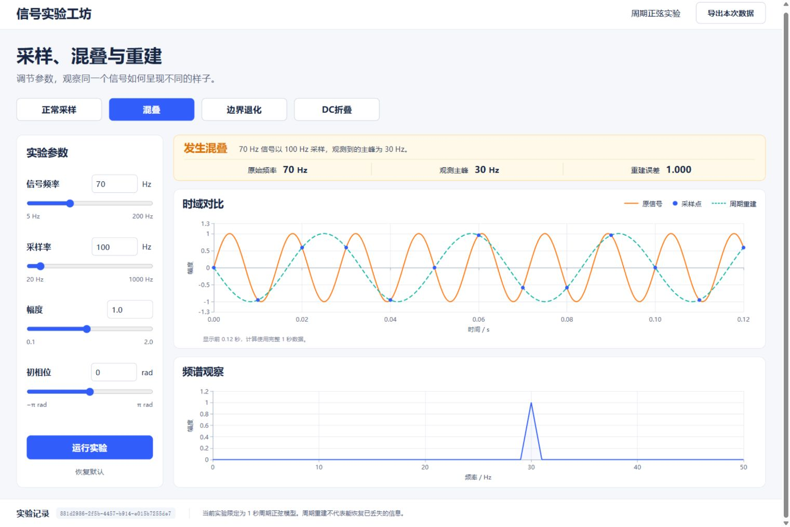

# 信号实验工坊

面向信号与通信基础学习的交互实验。学习者先保存预测，再运行采样或低通滤波实验，结合波形、频谱和本地 AI 指导核对结果，最后完成新参数迁移题。

- 自由实验覆盖正常采样、混叠、奈奎斯特边界、直流折叠和双频信号低通滤波。
- 引导学习提供六组采样练习和一组滤波练习，保存预测、运行、观察与服务端判分。
- 本地 Qwen 模型选择观察重点、指标引用及对照参数。应用按实际记录生成科学说明，用户确认后运行对照。
- 运行编号绑定参数、指标和曲线，同一标签页刷新可恢复进度，学习记录可导出 JSON 和 CSV。



## 从哪里开始

| 拿到的材料 | 包含什么 | 下一步 |
| --- | --- | --- |
| GitHub 仓库或源码 ZIP | 源码、依赖锁文件、启动脚本、测试和开发证据 | 完成「准备环境」「安装依赖」「启动网页」，再按需要准备本地模型 |
| 完整作品包 | 上述内容，以及 `model/` 中的 GGUF 权重、`runtime/` 中的运行包和演示材料 | 解压到空目录，完成相同的依赖安装。本地 AI 部分可直接校验包内文件 |

从源码克隆时运行以下命令。完整作品包用户直接进入解压目录。

```powershell
git clone https://github.com/K17-zhou/signal-lab.git
Set-Location .\signal-lab
```

以下命令都在项目根目录执行。这里应同时能看到 `README.md`、`backend`、`frontend`、`scripts` 和 `.env.example`。从 GitHub 下载源码 ZIP 时，先进入 ZIP 解压后实际包含这些文件的那一层目录。

## 1. 准备环境

当前验证环境为 **Windows 11 x64、Python 3.13.13、Node.js 24.16.0、npm 11.13.0、PowerShell 7.6.9**。项目声明 Python ≥3.12，前端依赖要求 Node.js ≥22.12，其他版本以实际安装结果为准。浏览器验收使用本机 Chrome。

先确认这些命令有输出。

```powershell
$PSVersionTable.PSVersion
python --version
node --version
npm.cmd --version
```

使用 PowerShell 7 打开项目终端。若缺少系统软件，使用其官方安装页面。 [Python Windows](https://www.python.org/downloads/windows/) · [Node.js](https://nodejs.org/en/download) · [PowerShell 7](https://learn.microsoft.com/en-us/powershell/scripting/install/installing-powershell-on-windows) · [Chrome](https://www.google.com/chrome/)

普通数值实验可以先独立运行。本地 AI 使用约 2.74 GB 的固定量化权重，本轮 GPU 环境为 RTX 4060 Laptop 8 GB 和 Vulkan 驱动。启动脚本也提供 `-Cpu` 入口，实际响应速度取决于机器。

## 2. 安装项目依赖

首次安装需要访问 Python 和 npm 软件包源。下面把临时目录与下载缓存放在项目内，并新建独立 Python 环境。

```powershell
New-Item -ItemType Directory -Force .cache/tmp | Out-Null
$env:TEMP = (Resolve-Path .cache/tmp).Path
$env:TMP = $env:TEMP
$env:PIP_CACHE_DIR = Join-Path $PWD.Path '.cache/pip'
$env:npm_config_cache = Join-Path $PWD.Path '.cache/npm'
$env:PYTHONUTF8 = '1'

python -m venv .venv
if ($LASTEXITCODE -ne 0) { throw 'Python 虚拟环境创建失败' }

.\.venv\Scripts\python.exe -m pip install --index-url https://pypi.org/simple -r .\backend\requirements.lock.txt
if ($LASTEXITCODE -ne 0) { throw 'Python 依赖安装失败，请查看上面的错误' }

Push-Location frontend
try {
    npm.cmd ci --registry https://registry.npmjs.org
    if ($LASTEXITCODE -ne 0) { throw '前端依赖安装失败，请查看上面的错误' }
} finally {
    Pop-Location
}
```

已有可用 `.venv` 和 `frontend/node_modules` 的后续启动可直接运行下面的脚本。依赖版本分别由 `backend/requirements.lock.txt` 和 `frontend/package-lock.json` 固定，前端安装使用 `npm ci`。

## 3. 启动网页并核对标准案例

在终端 A 运行应用。该脚本先构建前端，然后启动同源网页与 API。

```powershell
.\scripts\start.ps1
```

打开 [实验页面](http://127.0.0.1:8000)。点「正常采样」，参数应为信号频率 **50 Hz**、采样率 **400 Hz**，摘要和频谱应显示 **50 Hz** 主峰。

应用健康检查为 [API health](http://127.0.0.1:8000/api/health)，应返回 `{"status":"ok"}`。接口说明位于 [API 文档](http://127.0.0.1:8000/docs)。

终端保持运行。按 Ctrl+C 可停止应用。已经完成构建时可以用 `.\scripts\start.ps1 -SkipBuild` 启动。若 8000 端口被占用，用 `.\scripts\start.ps1 -Port 8001`，随后访问 `http://127.0.0.1:8001`。

## 4. 准备并启动本地 AI

### 4.1 准备固定文件

默认文件布局如下。

```text
signal-lab/
  model/
    Qwen3.5-4B-Q4_K_M.gguf
  runtime/
    llama-b11814-bin-win-vulkan-x64.zip
  .cache/runtimes/llama-b11814/
    llama-server.exe
    运行包中的 DLL 等其他文件
```

完整作品包已带前两个文件。源码仓库用户可以从固定上游地址下载到相同位置。下载中断后可再次执行命令，curl 会从已保存的部分文件继续。

```powershell
New-Item -ItemType Directory -Force model, runtime | Out-Null

$runtimeUrl = 'https://github.com/ggml-org/llama.cpp/releases/download/b11814/llama-b11814-bin-win-vulkan-x64.zip'
curl.exe --fail --location --continue-at - --output '.\runtime\llama-b11814-bin-win-vulkan-x64.zip' $runtimeUrl
if ($LASTEXITCODE -ne 0) { throw '运行包下载未完成，可保留文件后重试' }

$modelUrl = 'https://huggingface.co/unsloth/Qwen3.5-4B-GGUF/resolve/e87f176479d0855a907a41277aca2f8ee7a09523/Qwen3.5-4B-Q4_K_M.gguf'
curl.exe --fail --location --continue-at - --output '.\model\Qwen3.5-4B-Q4_K_M.gguf' $modelUrl
if ($LASTEXITCODE -ne 0) { throw '模型下载未完成，可保留文件后重试' }
```

使用完整包和下载文件的两条路径都执行下面的校验与解压。把运行包内的全部文件放入目标目录。

```powershell
$runtimeZip = '.\runtime\llama-b11814-bin-win-vulkan-x64.zip'
$runtimeSha256 = '0df9335f755538317d59b3442d9b28d68635742f381cdec743221c8dca7a4040'
if ((Get-FileHash -Algorithm SHA256 -LiteralPath $runtimeZip).Hash -ne $runtimeSha256) {
    throw '运行包 SHA-256 不匹配，请核对文件是否完整'
}
Expand-Archive -LiteralPath $runtimeZip -DestinationPath '.\.cache\runtimes\llama-b11814' -Force

$modelFile = Get-Item -LiteralPath '.\model\Qwen3.5-4B-Q4_K_M.gguf'
$modelSha256 = '00fe7986ff5f6b463e62455821146049db6f9313603938a70800d1fb69ef11a4'
if ($modelFile.Length -ne 2740937888 -or
    (Get-FileHash -Algorithm SHA256 -LiteralPath $modelFile.FullName).Hash -ne $modelSha256) {
    throw '模型大小或 SHA-256 不匹配，请继续下载或核对固定版本'
}
```

### 4.2 在终端 B 启动模型

另开一个 PowerShell 7 终端，进入同一项目根目录。

```powershell
.\scripts\start-tutor.ps1
```

该服务默认用 Vulkan0、2048 token 上下文、单并发和 4 个 CPU 线程，关闭思考模式。健康检查 [模型 health](http://127.0.0.1:8081/health) 返回 `{"status":"ok"}` 后再获取指导。

使用 CPU 的命令为 `.\scripts\start-tutor.ps1 -Cpu`。指定其他模型文件位置可用 `-ModelPath 'D:\models\Qwen3.5-4B-Q4_K_M.gguf'`。相对路径按项目根目录解析，启动时仍会核对登记的模型指纹。

### 4.3 走通一次真实指导

1. 保持终端 A 和终端 B 都在运行，打开 [引导学习](http://127.0.0.1:8000/#learn)。
2. 保留默认的「观察到的频率来自哪里」，输入 **22 Hz** 并点「保存预测」。
3. 点「运行本题实验」。原信号为 **70 Hz**、采样率 **110 Hz**，实测主峰应为 **40 Hz**。
4. 点「获取 AI 指导」。说明应结合已保存的预测与当前运行，引用按钮可定位到本次实测数据。
5. 若有对照建议，先核对参数，再点「确认运行对照实验」。新运行独立保存。
6. 完成迁移题后刷新页面，核对原预测、运行和判分已恢复。顶部可导出会话 JSON 与 CSV。

第一条模型请求需要处理初始上下文。应用指导超时预算为 30 秒，失败会显示具体提示。普通练习模式可在服务就绪后再次请求。

## 配置与数据目录

`.env.example` 列出可选变量。当前程序从终端环境读取变量，复制为 `.env` 本身不会自动加载。默认配置即可完成上面的普通练习。

| 变量 | 默认值或用途 |
| --- | --- |
| `SIGNAL_LAB_TUTOR_PORT` | `8081`，应用调用的本机模型端口 |
| `SIGNAL_LAB_TUTOR_MODEL` | `signal-lab-tutor`，应用和模型启动脚本使用同一别名 |
| `SIGNAL_LAB_DB_PATH` | 默认 `.cache/signal-lab.sqlite3`，保存运行和匿名学习事件 |
| `SIGNAL_LAB_STUDY_ASSIGNMENTS` | 用于隔离的 B/C 试用服务，普通练习无需设置 |

例如模型端口要改成 8082，终端 B 用 `.\scripts\start-tutor.ps1 -Port 8082`。终端 A 在启动应用前执行 `$env:SIGNAL_LAB_TUTOR_PORT = '8082'`，然后运行 `.\scripts\start.ps1`。

浏览器在同一标签页保存匿名会话编号。新练习使用页面上的「新建会话」，数据可按会话导出。 [学习接口与试用说明](evaluation/protocol.md)

## 自动验收

先安装本机 Chrome。下面的命令依次运行后端 pytest、前端 Vitest、生产构建和主要 Chrome 流程。

```powershell
.\scripts\check.ps1
```

退出码为 0 表示各阶段通过。脚本输出当前检查目录，浏览器截图、跟踪及合成服务日志在该目录内。合成用例使用独立数据库。最近冻结验收为 130 项后端、16 项前端单测和 9 条浏览器流程。 [执行记录](deliverables/冻结复验记录.txt)

也可导出 S1–S4 的命令行计算数据，输出目录需要是新目录。

```powershell
Push-Location backend
try {
    ..\.venv\Scripts\python.exe -m app.demo --output ..\artifacts\sampling-foundation
} finally {
    Pop-Location
}
```

## 常见问题

| 现象 | 检查或处理 |
| --- | --- |
| 找不到 `python`、`node` 或 `npm.cmd` | 安装对应系统软件后重新打开终端，按「准备环境」核对版本 |
| 脚本提示缺少虚拟环境或前端依赖 | 回到项目根目录完成 `python -m venv .venv`、pip 和 `npm ci`，检查安装命令是否成功退出 |
| PowerShell 阻止执行 `.ps1` | 确认使用 PowerShell 7，按本机脚本策略运行已核对的项目源码。也可按下方的手动启动命令运行网页 |
| 运行包或模型校验不通过 | 确认文件名、固定版本、长度和 SHA-256，下载中断时对同一部分文件用 `curl.exe --continue-at -` 续传 |
| Vulkan 设备不可用 | 检查显卡驱动及 Vulkan 支持，或选 `-Cpu` 启动 |
| 模型服务未就绪或指导显示 502/504 | 先核对 `8081/health`、终端 B 的日志，再核对端口和别名。普通练习可在服务恢复后重试 |
| 端口已占用 | 通过 `-Port` 选择空闲端口，并按「配置」同时调整应用调用的模型端口 |
| 浏览器测试找不到 Chrome | 安装 Chrome 并重新运行 `scripts/check.ps1` |
| 第一次依赖安装网络失败 | 根据错误恢复软件包源连接，再运行同一安装步骤。保留锁文件并继续用 `npm ci` |

脚本受策略限制时，可以直接执行应用底层启动命令。在终端 A 先构建，再运行 API。

```powershell
Push-Location frontend
try {
    npm.cmd run build
    if ($LASTEXITCODE -ne 0) { throw '前端构建失败' }
} finally { Pop-Location }

Push-Location backend
try {
    ..\.venv\Scripts\python.exe -m uvicorn app.main:app --host 127.0.0.1 --port 8000
} finally { Pop-Location }
```

## 计算范围与实际结果

| 案例 | 信号频率 / 采样率 | 应观察到的结果 |
| --- | --- | --- |
| S1 | 50 / 400 Hz | 主峰 50 Hz，无混叠，周期重建 RMSE < 10⁻¹⁰ |
| S2 | 70 / 100 Hz | 主峰 30 Hz，重建为负 30 Hz 正弦 |
| S3 | 50 / 100 Hz，零相位 | 奈奎斯特边界，样本接近零，无有效主峰 |
| S4 | 100 / 100 Hz，零相位 | 欠采样折叠到直流且样本退化，无有效主峰 |

采样实验采用整数频率、整数采样率和固定 1 秒周期模型。重建曲线具有周期假设。低通实验使用四阶数字 Butterworth 单向滤波器，保留启动瞬态与相移，幅度增益取最后 1 秒稳态窗口。

11 月 7 日在同机空目录 `测试` 中独立克隆，重新创建环境并安装锁定依赖。使用预置模型和运行包，累计约 2 分 3 秒到应用与模型就绪，2 分 38 秒完成 README 演示和六组真实 C 指导，3 分 20 秒完成全量回归。首条真实指导为 4.522 秒，调用前没有手工预热。 [本轮报告与原始结果](evaluation/repository-reproduction.md)

真人学习效果目前为「未测」，异机复现待测。11 月 6 日历史全量在线下载含中断续传为 17 分 26 秒，超过 10 分钟目标。完整作品包可使用已备文件；软件包源、系统工具及显卡驱动仍由运行环境提供。 [历史复现记录](evaluation/reproduction.md)

## 开发证据与材料

- [v1.1 版本附件](https://github.com/K17-zhou/signal-lab/releases/tag/v1.1)提供演示视频、两份 PDF 与校验值。源码安装按本文执行，模型与运行包下载地址在「本地 AI」部分。
- [AI 协同开发证据及三条完整链](deliverables/AI协同开发证据.md)
- [技术文档源稿](deliverables/技术文档提纲.md) · [作品说明](deliverables/作品说明.md)
- [真实模型的科学正文与浏览器验收](evidence/ai-development/2026-11-05-tutor-grounded.md)
- [低通滤波与迁移题](evidence/ai-development/2026-11-05-lowpass-filtering.md)
- [用例、试用状态和限制](evaluation/results.md)
- [设计基线](docs/superpowers/specs/2026-11-03-signal-lab-design.md)
- [提交清单与发布状态](deliverables/提交清单.md)

本地模型使用固定 Unsloth GGUF 量化文件和 llama.cpp。完整作品包附相应上游许可与来源，仓库中的依赖版本由锁文件记录。 [固定模型](https://huggingface.co/unsloth/Qwen3.5-4B-GGUF/tree/e87f176479d0855a907a41277aca2f8ee7a09523) · [llama.cpp b11814](https://github.com/ggml-org/llama.cpp/tree/b11814)
