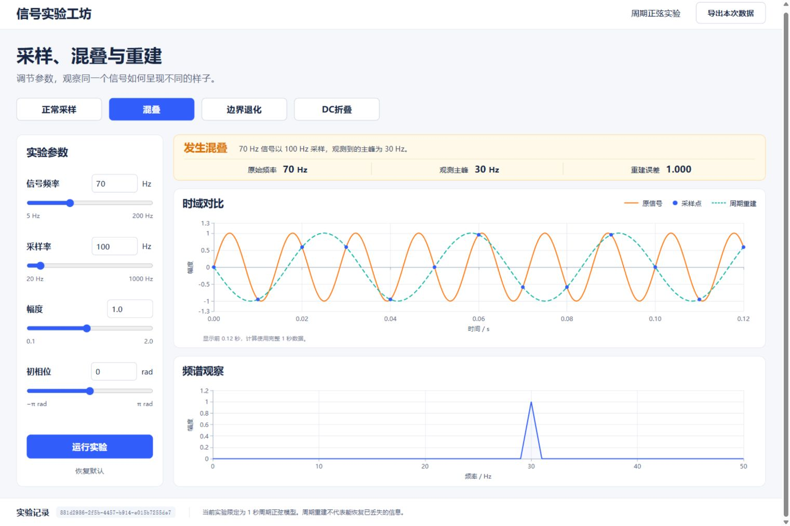

# Task 2 真实实验网页与主峰显示

[完整 Prompt 链](task2-prompt-chain.md)收录该轮全部可见对话。以下摘录与命令、失败输出及复验结果对应。

“继续推进吧”的具体上游是用户已知晓的产品与计划，以及主记录第 893 行的“运行 API＋最小波形页面”建议。此前设计约束、实际图像工具 prompt 和审查模型读取的输入见[前置上下文](context.md#链-1真实运行页面--读数修复)；它们单列为上下文，不伪装成该轮新增的用户长指令。

## 开发对话原文

同一项目主记录。前两条取自 `2026-11-03-interactive-lab-turn.partial.jsonl` 私有快照，快照截取主记录第 900–1412 行。后两条是快照截止之后的原会话消息。时间为 UTC。

| 角色 | 时间 | 主记录行号 | 私有快照行号 |
| --- | --- | ---: | ---: |
| 用户 | 2026-11-03 12:06:59.772Z | 900 | 1 |
| Codex | 2026-11-03 12:07:04.900Z | 903 | 4 |
| Codex | 2026-11-03 12:45:26.860Z | 1448 | — |
| Codex | 2026-11-03 12:49:53.755Z | 1497 | — |

1. 用户

   > 继续推进吧

2. Codex

   > 我会继续推进运行接口和最小实验页面，让你能在网页上调参数，查看真实计算出的波形、频谱和重建结果。

3. Codex

   > 独立审查没有发现阻断问题，确认了一个显示细节：部分采样率会让主峰读数出现浮点尾数。我会修正界面显示并保留导出中的原始数值，然后完成收尾。

4. Codex

   > 显示问题已修复并通过验证：前端现有6项测试全部通过，5/49和54/49两个真实实验均显示主峰5 Hz，原始数据精度保留。现在保存最终版本和截图，下一步可进入“先预测—做实验—迁移题”的学习流程。

Codex 还调用了图像生成工具建立桌面界面参考。以下是原始工具提示词中的一句。完整提示词已存入 `docs/design/concept-generation.md`。本页附图取自实际网页验收。

> Four working-case buttons in a horizontal row: "正常采样", "混叠", "边界退化", "DC折叠". Show 混叠 selected.

## 失败、修复与复验

`6b4577e` 接通真实运行 API、SQLite、参数调节和绘图。独立审查发现 `f0=5 Hz`、`fs=49 Hz` 时，主峰标签展示了浮点尾数。开发中为充分采样和欠采样各写了一条测试，再从 `frontend` 运行实际命令中的测试部分。命令见主记录第 1449 行，失败输出见 `2026-11-03-frequency-display-red.log` 第 18–21、50–51 行，分段摘录如下。

```powershell
npm.cmd run test -- --run src/features/lab/RunSummary.test.tsx
```

```text
Expected element not to have text content:
  5.000000000000001
Received:
  采样充分5 Hz 信号以 49 Hz 采样，当前周期模型可重建。原始频率5 Hz观测主峰5.000000000000001 Hz重建误差< 0.001
```

```text
 Test Files  1 failed (1)
      Tests  2 failed (2)
```

`fe74ade` 在 `frontend/src/features/lab/format.ts` 增加频率标签格式化。`RunSummary.tsx` 和 `SignalPlots.tsx` 共同使用它，回归测试同时断言原始 `run.metrics.peak_frequency_hz` 仍为 `5.000000000000001`。从 `frontend` 复跑的测试子命令见主记录第 1458、1466 行。通过输出见 `2026-11-03-frontend-green.log` 第 9–10 行。

```powershell
npm.cmd run test -- --run
```

```text
 Test Files  2 passed (2)
      Tests  6 passed (6)
```

浏览器使用真实计算结果复验。`2026-11-03-precision-browser.json` 中两条记录的 `summary` 都含 `观测主峰\n5 Hz`，参数分别为 `5 Hz / 49 Hz` 和 `54 Hz / 49 Hz`。附图为同轮另一条标准混叠用例 `70 Hz / 100 Hz`，画面显示 `30 Hz` 观测主峰。该图用于复核页面与图表，`5 Hz` 的显示结果以精度用例记录为准。



**项目来源**　`evidence/ai-development/2026-11-03-interactive-lab.md`、`2026-11-03-interactive-raw-export-manifest.json`、上述测试及浏览器记录。完整仓库路径见[来源索引](source-manifest.json)。
