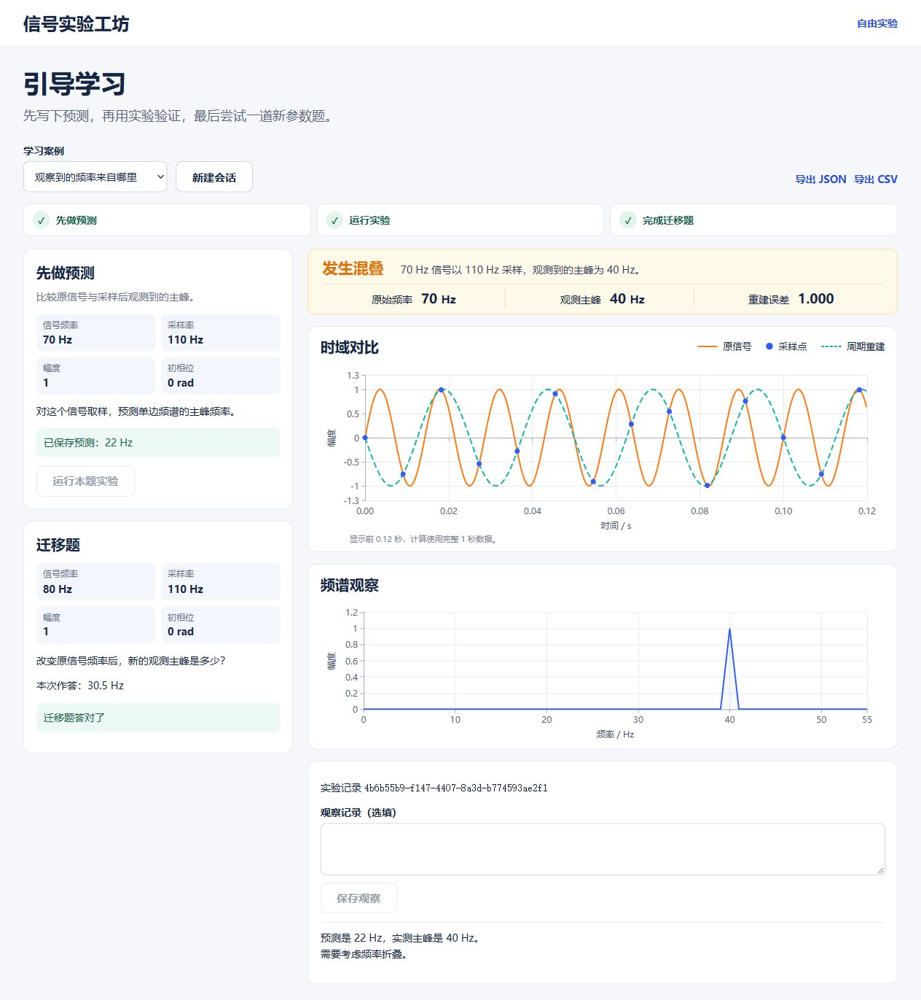

# Task 3 学习事件、导出上下文和超时恢复

[完整 Prompt 链](task3-prompt-chain.md)收录该轮全部可见对话。以下摘录与命令、失败输出及复验结果对应。

“继续做”承接主记录第 1529 行用户要求保存的次日交接，以及第 1571 行明确的 Task 3 学习记录与服务端判题。原预测恢复、迁移换参数和可还原导出的实际计划输入见[前置上下文](context.md#链-2可还原的学习记录--csv-上下文与超时修复)，不将助手撰写的技术约束归为用户原话。

## 开发对话原文

同一项目主记录，来自 `2026-11-04-guided-learning-turn.partial.jsonl` 私有快照。该快照对应主记录第 1590–1905 行，止于当轮文档收尾前。时间为 UTC。

| 角色 | 时间 | 主记录行号 | 私有快照行号 |
| --- | --- | ---: | ---: |
| 用户 | 2026-11-04 02:39:12.317Z | 1590 | 1 |
| Codex | 2026-11-04 02:39:24.282Z | 1593 | 4 |
| Codex | 2026-11-04 03:03:44.170Z | 1837 | 248 |
| Codex | 2026-11-04 03:06:38.712Z | 1903 | 314 |

1. 用户

   > 继续做

2. Codex

   > 我会按昨晚的接续记录，从学习事件保存和服务端判题做起。沿用 Superpowers 的执行计划和测试驱动流程，先用测试钉住重复提交、会话隔离和判题边界。

3. Codex

   > 审查确认了一个导出缺口：CSV 记录了迁移题的作答，却只带原实验参数，离线查看容易把两组参数混在一起。我会补齐题目、选项和迁移参数，再核对下载结果。

4. Codex

   > 两项审查问题都已修复。CSV 现在分别记录原实验的 70 Hz 和迁移题的 80 Hz，读取超时也会出现重试入口。回归测试和构建已通过，本机体验服务已启动，原有 12 条实验记录仍在。

## 失败、修复与复验

`297671e` 增加预测、运行、观察和迁移作答的持久化。审查后新增两组回归检查，分别覆盖迁移题导出缺列和挂起请求的反馈。下面保留主记录第 1839、1851 行工具调用中的测试子命令及失败输出。

**迁移题导出**　从 `backend` 执行。

```powershell
..\.venv\Scripts\python.exe -m pytest tests/test_learning.py -q -k exports --tb=short
```

`2026-11-04-learning-csv-red.log` 第 5–7 行。

```text
    assert csv_rows[3]["question_id"] == "alias-transfer"
           ^^^^^^^^^^^^^^^^^^^^^^^^^^
E   KeyError: 'question_id'
```

**题库请求超时**　从 `frontend` 执行。测试用可控挂起请求触发超时。

```powershell
npm.cmd run test -- --run src/features/learning/LearningFlow.test.tsx -t 'catalog times out'
```

`2026-11-04-learning-timeout-red.log` 第 14–15 行。

```text
 FAIL  src/features/learning/LearningFlow.test.tsx > guided learning > offers a retry when loading the exercise catalog times out
TestingLibraryElementError: Unable to find role="alert"
```

`1c8897f` 在 `backend/app/learning.py` 加入题号、题干、题目参数和选项等 CSV 字段。在 `frontend/src/features/learning/learningApi.ts` 将 15 秒超时设在公共请求入口，并与浏览器页面自身的取消信号合并。修复后后端全量和前端全量的保存输出分别为以下两段。

```text
52 passed in 7.01s
```

```text
 Test Files  3 passed (3)
      Tests  10 passed (10)
```

从 `2026-11-04-guided-browser-sample.csv` 与同名 JSON 核对出四个顺序一致、事件编号一致的事件。实际 CSV 的 `transfer` 行记录 `question_id=alias-transfer`、`answer_value=30.5` 和 `outcome=correct`。其中 `question_params.frequency_hz=80`，`run_params.frequency_hz=70`，两组采样率均为 `110 Hz`。测试用 `30.5 Hz` 作答；浏览器刷新后恢复 22 Hz 预测、40 Hz 图表、观察和判定。两个格式均来自开发验收的合成会话。



**项目来源**　`evidence/ai-development/2026-11-04-guided-learning.md`、`2026-11-04-guided-raw-export-manifest.json`、`2026-11-04-learning-backend-green.log` 第 2 行、`2026-11-04-learning-frontend-green.log` 第 9–10 行、上述失败与导出记录。完整仓库路径见[来源索引](source-manifest.json)。
