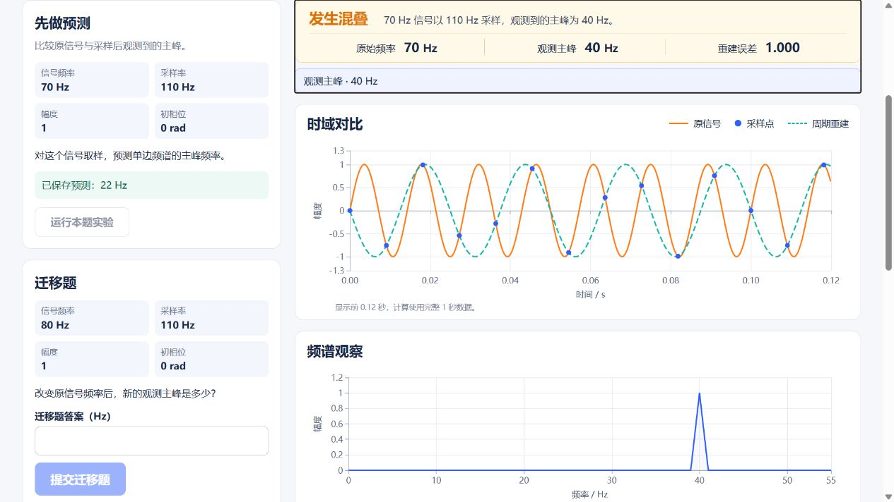
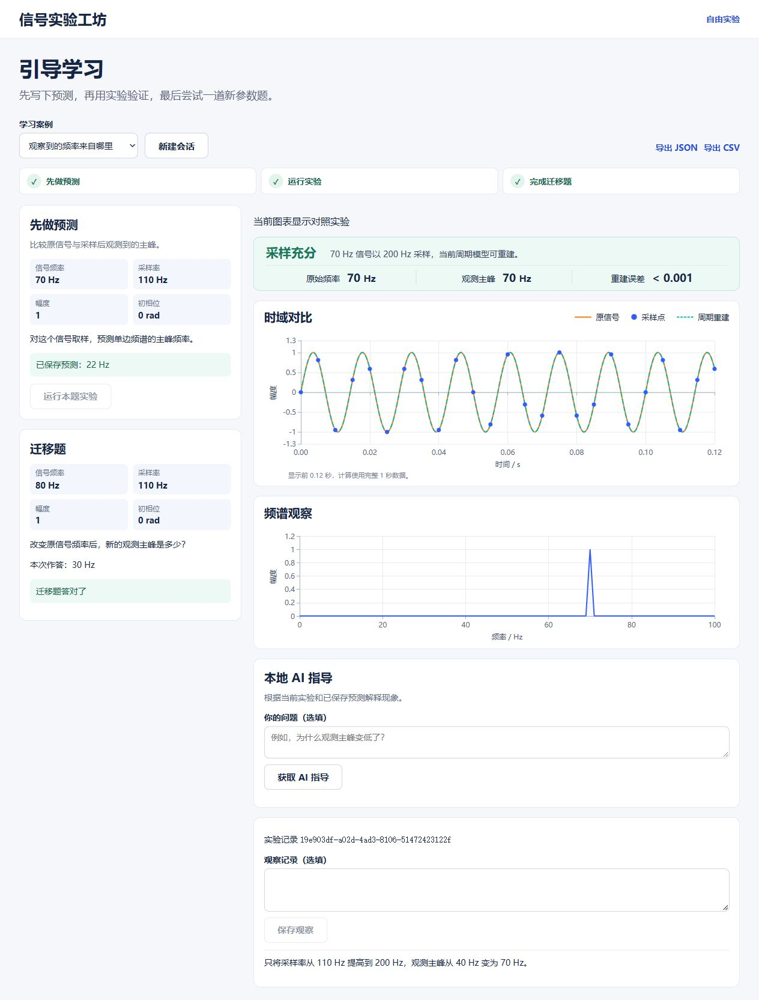

# Task 4 本地模型 HTTP 502 修复与科学正文复验

[完整 Prompt 链](task4-prompt-chain.md)收录三轮全部可见对话。以下摘录与探针、实际请求及浏览器验收对应。

[实际 C 模式输入／原始输出、B 模式真实错误与职责边界](context.md#链-3真实请求失败--收紧科学正文责任)另行留存。C 的科学正文由程序根据已保存指标生成；模型负责选重点、证据及对照参数，不能把应用正文当成模型自由推理的全部原文。

## 开发对话原文

取自同一项目聊天 2026-11-04 15:55:54（北京时间）开始的接续记录。表中时间为 UTC，行号属于该接续记录。私人路径和聊天标识省略，以下引用均来自可见消息。

| 角色 | 时间 | 接续记录行号 |
| --- | --- | ---: |
| 用户 | 2026-11-05 02:21:31.331Z | 591 |
| Codex | 2026-11-05 02:21:36.450Z | 594 |
| Codex | 2026-11-05 02:27:27.424Z | 787 |
| 用户 | 2026-11-05 03:02:40.099Z | 1146 |
| 用户 | 2026-11-05 07:55:30.566Z | 1471 |
| Codex | 2026-11-05 07:56:01.708Z | 1478 |

1. 用户

   > 继续做

2. Codex

   > 今天从 Task 4 的真机验收接着做。我会按执行计划和完成前验证技能，先让启动脚本识别已下载的 Qwen3.5-4B，再跑至少 10 条真实指导请求，核对解释、引用、延迟和显存。

3. Codex

   > 已定位到 502 的原因。客户端把 JSON 约束放在了 llama.cpp 不读取的位置，修正后，已返回的用例都通过了结构和引用校验。人工核对又发现一条边界解释把近零样本误说成直流折叠，我会补清这条理论约束后复测。

4. 用户

   > 那你继续做吧，把task4做完

5. 用户

   > 继续完成task4

6. Codex

   > 我从 Task 4 剩下的浏览器验收接着做，重点核对实际页面、点击证据后的定位，以及确认对照后图表和主峰是否一起更新。

## 真实请求失败、定位与修复

首轮通过应用的 `/api/tutor/guide` 请求本机 Qwen3.5-4B Q4_K_M。`2026-11-05-tutor-real-samples.json` 的 `previous_rounds[0].summary` 记录 10 条请求、0 条 HTTP 200。`previous_rounds[0].samples[0]` 是保存的首轮样本之一，状态 502，`reply.detail` 为 `invalid_tutor_reply`。该条 `context.message` 和 Qwen `raw` 中的 `evidence` 字段如下，`raw` 其余字段略。提问来自合成用例。

> 为什么观测主峰不是 70 Hz？请解释我的预测与当前实验。

```text
"evidence": [
  "sampling_state",
  "alias_frequency_hz",
  "sample_rate_hz"
]
```

Codex 向本机 llama.cpp b11814 发送常量字段探针，使用同一条实际探针提示词 `Respond with exactly the lowercase word pong and no other text.`。接续记录第 710 行为工具调用，第 714 行为输出。下面将两种请求的模型 `content` 解码值压成单行展示，终端包装和第三种 `json_object` 变体略。

| `response_format.type` | 探针使用的 Schema 位置 | 该次返回的 `content` |
| --- | --- | --- |
| `json_schema` | `response_format.schema` | `{"error":"Invalid response format","message":"The requested output must be exactly the lowercase word 'pong' with no other text."}` |
| `json_schema` | `response_format.json_schema.schema` | `{"status":"SCHEMA_WAS_APPLIED"}` |

同轮先运行新增的客户端回归测试。实际测试子命令从 `backend` 执行，见接续记录第 723 行。第 730 行退出码为 `1`，下面摘出失败断言和错误。

```powershell
& ../.venv/Scripts/python.exe -m pytest -q tests/test_tutor.py -k 'schema_in_llama'
```

```text
>       schema = payload["response_format"]["json_schema"]["schema"]
E       KeyError: 'json_schema'
```

`439ec17` 修改 `backend/app/tutor/client.py`，将约束传在 `response_format.json_schema.schema`，让运行编号和证据对象的 Schema 生效。`previous_rounds[1]` 的 `nested_schema` 批次记录 10 条请求和 10 条 HTTP 200。两批各保留了汇总和所选原始回复。后续真实 `final_batch.rows` 保存了 10 条完整的应用响应记录。该轮结构与引用通过后，人工仍记录了漏答原预测与边界因果表达不准确的问题。

## 复验科学正文和浏览器交互

`0f04a4e` 收紧 C 模式的职责。Qwen 返回观察重点、引用字段及可选对照参数，后端使用已保存的实验数据和预测来生成科学说明。`2026-11-05-tutor-grounded-samples.json` 的 `final_batch.rows` 中有 10 条真实请求，HTTP 状态均为 200，关键事实和引用逐条核对通过。第 1 条的应用正文摘录如下，保留连续句子，前后段落略。

> 理论折叠频率为 40 Hz。观测主峰为 40 Hz。本次运行属于欠采样。

`eea6a97` 记录真实浏览器验收。70 Hz 信号以 110 Hz 采样，点击指导中的 40 Hz 引用后，页面滚动并聚焦到实验摘要。确认对照后才创建新运行，采样率提高到 200 Hz，观测主峰回到 70 Hz。刷新后恢复 22 Hz 原预测、对照结果和迁移判分，JSON 和 CSV 各有五个事件。这是独立的浏览器验证轮次，其对照参数来自该轮实际模型响应。





**项目来源**　`evidence/ai-development/2026-11-05-tutor-real.md`、`2026-11-05-tutor-real-samples.json`、`2026-11-05-tutor-grounded.md`、`2026-11-05-tutor-grounded-samples.json` 和上述接续记录。完整仓库路径见[来源索引](source-manifest.json)。
