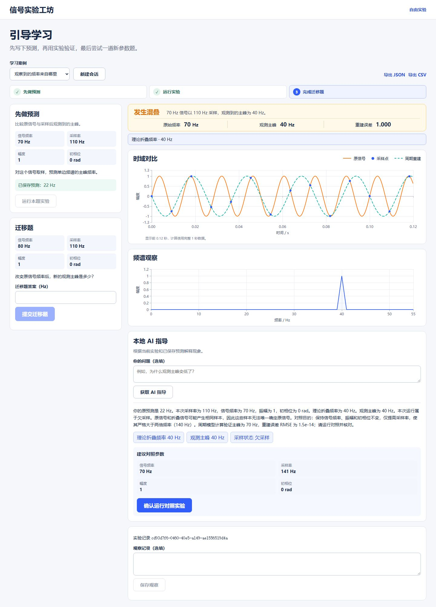
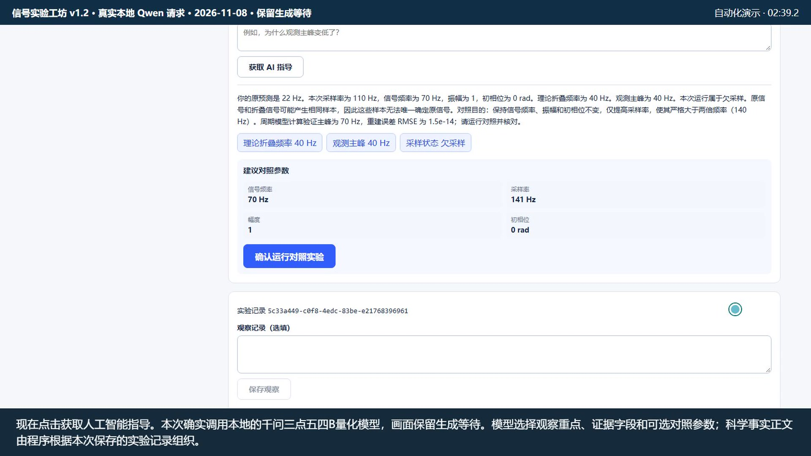

# 信号实验工坊 · 作品说明

## 第 01 页　信号实验工坊

**面向通信原理学习的交互实验与本地 AI 指导**

采样课上，70 Hz 的原信号以 110 Hz 采样，频谱主峰却在 40 Hz。信号实验工坊面向学习信号与通信基础的大学生，通过可调参数和可追溯的实验记录，帮助学习者解释这个差异，再用新参数检验自己的判断。作品可用于课堂演示和课后练习。

- **自由实验**提供四组采样预设和一组低通预设，可调整参数、查看指标并导出计算数据。
- **引导学习**包含六组采样练习和一组滤波练习。原预测、实验和迁移题判分保存在同一会话，支持同一标签页刷新恢复和 JSON、CSV 导出。
- **本地 AI 指导**用于采样练习。模型选取本次运行的证据和对照参数，程序据实生成说明并验算建议。学习者可点击证据定位数值，确认后运行有效对照。

图 1　v1.2 自动化验收截图。① 保存的 22 Hz 演示预测。② 70 Hz 信号以 110 Hz 采样得到的 40 Hz 主峰。

### 启动与使用

在 Windows x64 上完整解压 v1.2 便携包，双击「开始演示.cmd」。看到 `READY` 后，浏览器打开实验页面。选「自由实验」调参，或进入「引导学习」体验第 2 页的案例。便携包已含 Python、依赖、前端、模型和推理程序。

**核查入口** [便携启动说明](../README.md#0-直接演示windows-x64-完整便携包) · [B 站演示](https://www.bilibili.com/video/BV1tz4x6dE2B/) · [GitHub 项目](https://github.com/K17-zhou/signal-lab)

## 第 02 页　从预测到迁移题

在「引导学习」中选择「观察到的频率来自哪里」。以下数据来自 v1.2 录制中的真实计算与模型调用，预测和作答由自动化演示填写。

| 操作 | 本次演示结果 |
| --- | --- |
| 保存预测，运行原题 | 填入 22 Hz 并保存。运行 70 Hz 信号、110 Hz 采样的实验，时域与频谱随本次运行更新，实测主峰为 40 Hz |
| 获取指导，定位证据 | 点击「获取 AI 指导」，再点「观测主峰 40 Hz」，页面定位到本次运行摘要，可对照原预测 |
| 确认运行对照 | 本次模型建议把采样率提高到 141 Hz，原信号参数固定。程序验算通过后显示确认按钮。确认后实测主峰为 70 Hz，重建 RMSE 约 1.5 × 10⁻¹⁴ |
| 回答迁移题，导出记录 | 信号改为 80 Hz，采样率仍为 110 Hz。提交 30 Hz 后服务端判对。刷新恢复原预测、对照和判分，可导出 JSON 或 CSV |

图 2　v1.2 演示片段。③ 可定位的 40 Hz 证据。④ 程序验算后可确认的 141 Hz 对照建议。

**关键技术**　React/ECharts 绘图，FastAPI、NumPy/SciPy 和 SQLite 完成计算、判题和持久化。llama.cpp 在本机运行 Qwen3.5-4B Q4_K_M。后端校验模型引用是否来自当前运行、建议是否能达到教学目的。

**AI 测试及实测**　Codex 协助编写回归，复现了 70 Hz 信号在 140 Hz 采样时旧版误放行的边界建议。修复后程序能过滤该建议。后端 155 项、前端 16 项、Chrome 流程 9 条均通过。最终 ZIP 在 RTX 4060 Laptop 8 GB/Vulkan 同机独立复现，从校验与解压开始 134.403 秒完成功能验证，耗时不含下载。CPU 指导曾超时，异机运行及真人学习效果未测。

**来源与发表情况**　从本项目初版设计迭代，使用上述开源组件及模型。源码和演示视频已公开，现有材料暂无论文发表或获奖记录。

**核查入口** [v1.2 演示实录](../evidence/ai-development/2026-11-07-demo-v1.2.json) · [AI 开发证据](AI协同开发证据.md) · [最终 ZIP 复现记录](../evaluation/portable-reproduction.md#11-月-8-日最终-zip-验收)
