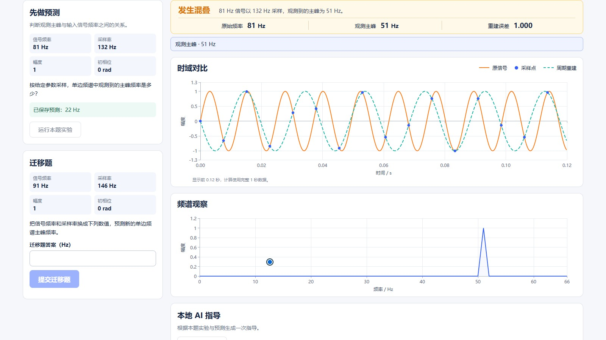

# 信号实验工坊 · 作品说明

**面向通信原理学习的交互实验与本地 AI 指导**

采样频谱的主峰为什么有时比输入频率低？为什么采样率恰好是信号频率的两倍，波形仍可能无法恢复？信号实验工坊面向正在学习信号与通信基础的大学生，将这些问题做成可调参的浏览器实验。学习者先写预测，再看时域曲线、采样点和频谱，最后用一题新参数检验自己的判断。

- **自由实验**提供正常采样、混叠、边界退化、直流折叠和低通滤波预设。学习者可修改参数，查看主峰、重建误差或幅度增益，并导出本次运行的计算数据。
- **引导学习**包含六组采样练习和一组滤波练习。服务端按固定规则判定迁移题，保存预测、运行和作答，支持同一标签页刷新恢复及 JSON、CSV 导出。
- **本地 AI 指导**采用 Qwen3.5-4B Q4_K_M。模型根据本次采样运行选择观察重点、证据和对照参数，应用据已保存记录生成说明。点击证据可定位到对应指标，用户确认后才运行对照。

在 C-Y 合成试跑中，81 Hz 信号以 132 Hz 采样，计算主峰为 51 Hz。确认将采样率提高到 200 Hz 后，新运行的主峰为 81 Hz，原预测和正式运行仍可追溯。

图 1　11 月 7 日真实浏览器演示。点击引用后，页面聚焦到对应运行的 51 Hz 主峰，左侧保留 22 Hz 的预设演示预测。

**运行与关键技术**　Windows 下按 README 安装锁定依赖，启动应用和本地模型，打开浏览器即可实验。前端使用 React 与 ECharts，后端通过 FastAPI、NumPy、SciPy 和 SQLite 完成计算、判题与记录。

**AI 测试技术落地**　用 AI 协助编写回归和定位缺陷，保留 Prompt、失败输出、修复提交和复测。真实模型曾因结构约束位置不匹配连续返回 502。用常量字段探针对照请求结构，再用真实请求核对修复后状态和引用。

**工程验证**　冻结验收通过 10 条留出用例、130 项后端测试、16 项前端单测、生产构建和 9 条浏览器流程。同一台 Windows 电脑从空目录到正常采样用时 2 分 32 秒，预置权重和运行包后到首次真实指导用时 3 分钟，全量在线路径用时 17 分 26 秒，超过 10 分钟目标。真人学习效果未测。

**项目来源与记录**　作品从本仓库实现，使用开源数值库、绘图库和本地模型。目前项目材料中暂无发表或获奖记录。

**对应源码**　`8aff7d9` · 省赛材料初版 v1.0

**核查入口** [技术文档](信号实验工坊-技术文档-v1.0.pdf) · [启动说明](../README.md) · [冻结验收与复现](../evaluation/reproduction.md) · [AI 开发证据](AI协同开发证据.md)
