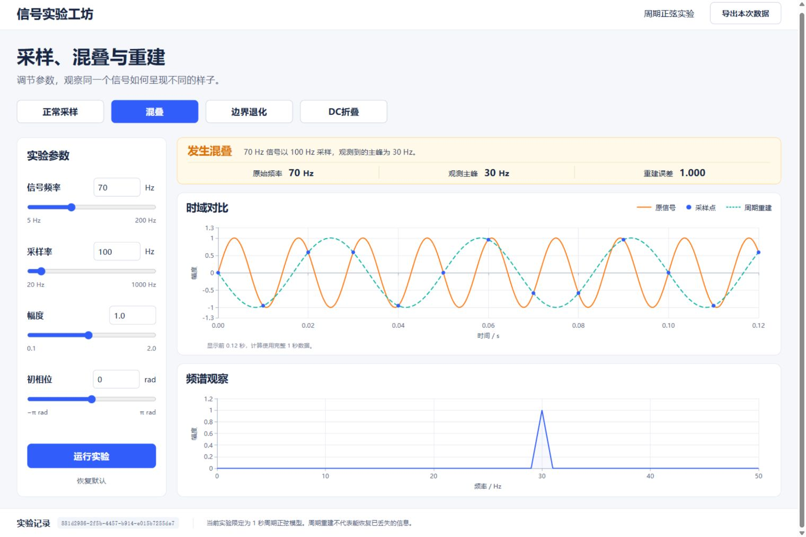
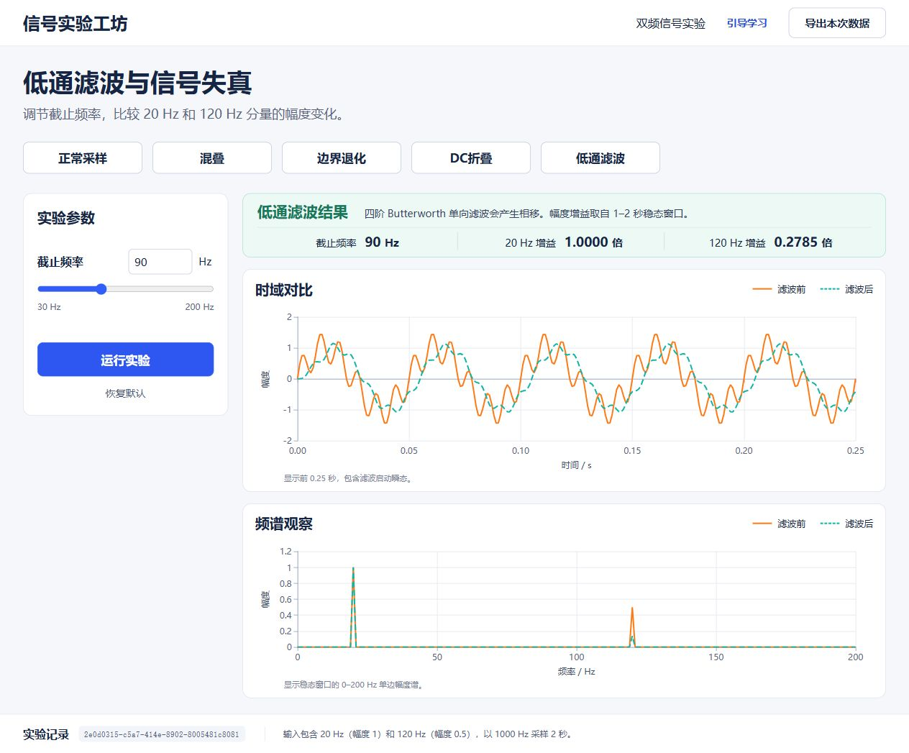
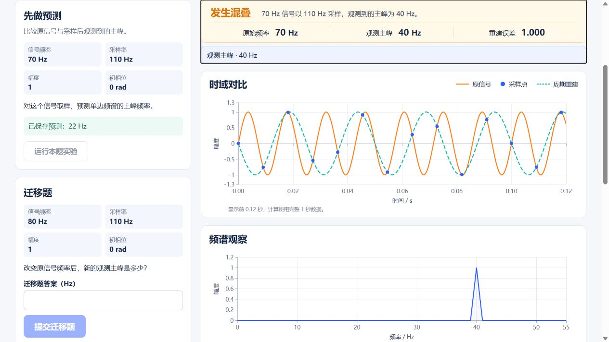
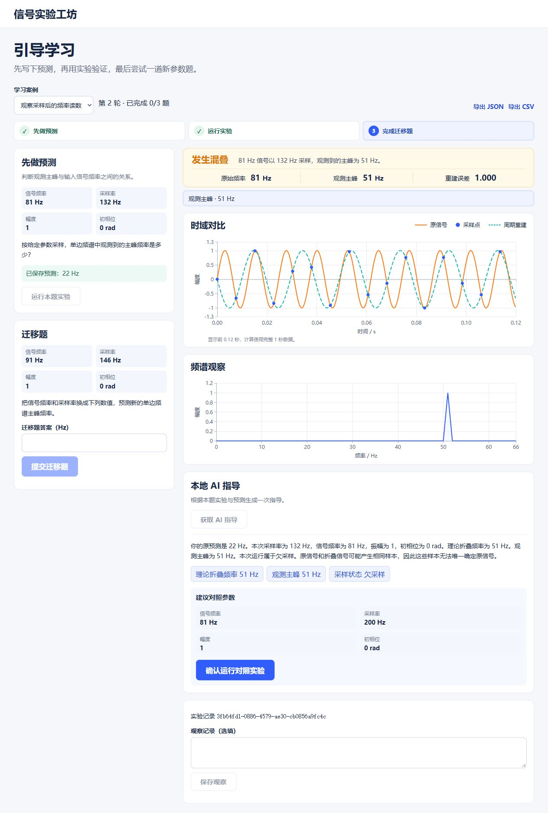

# 信号实验工坊技术文档

## 第 01 页　信号实验工坊

**面向通信原理学习的交互实验与本地 AI 指导**

学习者先预测采样或滤波的结果，再动手调参、查看时域和频域证据，并用一题新参数检验自己能否迁移判断。作品提供自由实验和引导学习两种入口，覆盖采样、混叠、周期重建和双频信号低通滤波。

自由实验提供四个采样预设和一个低通预设，支持自行调参和导出本次运行。引导学习提供六组采样练习和一组滤波练习，保存原始预测、运行、观察与迁移判分。采样练习可请求本地 AI 指导，证据可跳转至对应实验摘要，模型建议的对照参数由学习者确认执行。

**材料版 v1.2** · 2026 年 11 月 8 日。运行代码与便携启动基线 `0b9e622`，保留 v1.1 的真实开发历史与冻结输入。

图 1　自由实验开发验收截图。70 Hz 正弦以 100 Hz 采样，频谱主峰为 30 Hz，周期重建与原信号的 RMSE 约为 1。

**核查入口** [项目说明](../README.md) · [设计基线](../docs/superpowers/specs/2026-11-03-signal-lab-design.md)

## 第 02 页　学习问题与方案取舍

同一组采样点可以对应不同的连续波形。学习者需要区分输入频率、理论折叠频率与样本频谱的观测主峰，也需要知道在两倍采样率处，初相位可以决定是否还能观测到主峰。作品把运行参数、观测主峰和重建误差与曲线关联。C 模式指导还可引用理论折叠频率，便于结合原预测判断差异来自哪里。

| 方法 | 主要用途 | 与本作品的关系 |
| --- | --- | --- |
| 概念可视化仿真 | PhET 的 Fourier 系列仿真通过可交互波形帮助探索谐波叠加 | 本作品聚焦离散采样和混叠，把预测、运行指标和迁移题写入同一会话 |
| 普通文本指导 | 本项目 B 模式从同一个本地模型获取自然语言说明，提供当前参数、指标和预测 | C 模式将可定位的指标引用与可确认的参数建议加入指导，科学说明由程序据实生成 |
| AI 接入专业仿真 | Wokwi 的 MCP 服务让代理运行嵌入式仿真、执行测试并查看串口输出 | 本作品将模型可提出的动作收敛为采样参数建议，沿用预定义的数值实验与判题规则 |

六组采样练习分别处理频谱主峰与原频率的混淆、奈奎斯特边界的误判、插值加密、光滑曲线误读、采样后低通的局限和初相位的影响。低通练习另用幅度增益训练对截止频率的判断。上表比较设计侧重点，B/C 真人比较的状态见第 08 页。

**核查入口** [PhET 仿真](https://phet.colorado.edu/sims/html/fourier-making-waves/1.0.2/fourier-making-waves_en.html) · [Wokwi MCP 文档](https://docs.wokwi.com/wokwi-ci/mcp-support) · [学习用例与错因键](../backend/content/assessment_keys.json)

## 第 03 页　学习流程与系统架构

**保存预测 → 运行原题 → 查看波形和频谱 → 按需查看指导或确认对照 → 完成迁移题 → 导出记录**

| 部件 | 职责与数据流 |
| --- | --- |
| 浏览器 | React、TypeScript、Vite 和 ECharts 构成页面。实验参数作为草稿编辑，图表和摘要读取已完成的同一运行。快速切换时取消旧请求，避免旧结果覆盖新图表 |
| 实验 API | FastAPI 接收 `sampling_aliasing` 或 `lowpass_filter`。Pydantic 校验类型和范围，NumPy/SciPy 计算曲线与指标，服务端持久化后返回新 `run_id` |
| 学习 API | 关联匿名会话、正式运行和对照运行，服务端按固定规则判题。同一 `event_id` 与相同内容重发返回原记录，内容冲突返回 409 |
| 本地模型服务 | 后端通过回环接口请求 llama.cpp。模型读取当前采样运行的摘要与已保存预测，返回指导选择。第 06 页说明模型可用的数据与动作 |

SQLite 保存运行参数、曲线、指标、警告和学习事件。每次成功运行都有独立编号，可按编号读取。同一标签页刷新后按匿名会话编号恢复进度，JSON 和 CSV 可导出该会话的记录。模型超时或离线时，已完成的实验、原预测和迁移判题仍可使用。

**核查入口** [API 与启动说明](../README.md) · [请求与响应类型](../backend/app/schemas.py) · [学习流程验证](../evidence/ai-development/2026-11-04-guided-learning.md)

## 第 04 页　采样、频谱和周期重建

**信号模型**　令 `x(t) = A sin(2π f₀t + φ)`，固定观察 1 秒。`f₀` 与采样率 `fₛ` 为整数，分别取 5–200 Hz 和 20–1000 Hz，`A` 取 0.1–2，`φ` 取 −π 到 π rad。引擎在 `t = n/fₛ` 直接计算原信号，`n` 从 0 到 `fₛ−1`。这样可以观察未做抗混叠预处理时的折叠现象。

**频谱和重建**　实数 FFT 幅度按 `2/N` 归一，DC 与偶数 `N` 的奈奎斯特频点只按 `1/N` 归一。由于观察窗为 1 秒，频点间隔为 1 Hz。理论折叠频率用 `|((f₀ + fₛ/2) mod fₛ) − fₛ/2|` 计算。样本 RMS 小于 `10⁻⁸` 时，观测主峰记为 `null`。用 Fourier 重采样将样本扩展至 4096 点周期网格，并与同网格原信号计算 RMSE。加密周期曲线只利用已有样本。 [SciPy FFT](https://docs.scipy.org/doc/scipy/reference/generated/scipy.fft.rfft.html) · [SciPy 周期重采样](https://docs.scipy.org/doc/scipy/reference/generated/scipy.signal.resample.html)

| 案例 | 原频率 / 采样率 | 理论折叠 / 观测主峰 | 计算结果 |
| --- | ---: | ---: | --- |
| S1 正常采样 | 50 / 400 Hz | 50 / 50 Hz | RMSE 约 1.02 × 10⁻¹⁴ |
| S2 欠采样 | 70 / 100 Hz | 30 / 30 Hz | 重建为 `−sin(2π·30t)`，RMSE 约 1 |
| S3 奈奎斯特边界 | 50 / 100 Hz | 50 Hz / 无有效主峰 | 样本接近零，RMSE 约 0.707 |
| S4 折叠到直流 | 100 / 100 Hz | 0 Hz / 无有效主峰 | 欠采样且样本接近零，RMSE 约 0.707 |

四个标准用例均取 `A = 1`、`φ = 0`。在 `fₛ = 2f₀` 时，样本为 `A(−1)ⁿ sin φ`，零相位让样本接近零，`π/2` 相位产生正负交替。边界无法保证原信号的唯一恢复。重建结论适用于这里的一秒周期模型。

**核查入口** [S1–S4 原始指标](../evidence/ai-development/2026-11-03-standard-cases.json) · [S3 边界截图](../evidence/screenshots/task2-boundary.jpg) · [采样引擎](../backend/app/experiments/sampling.py)

## 第 05 页　低通滤波与迁移判题

低通实验以 1000 Hz 采样 2 秒，输入是幅度 1 的 20 Hz 正弦和幅度 0.5 的 120 Hz 正弦之和。四阶数字 Butterworth 用二阶节表示，以 `sosfilt` 单向滤波。时域图保留启动瞬态和因果相移，幅度增益按 1–2 秒稳态窗口计算同一频点的输出幅度与输入幅度之比。 [SciPy Butterworth](https://docs.scipy.org/doc/scipy/reference/generated/scipy.signal.butter.html) · [SciPy 二阶节滤波](https://docs.scipy.org/doc/scipy/reference/generated/scipy.signal.sosfilt.html)

| 截止频率 | 20 Hz 增益 | 120 Hz 增益 |
| ---: | ---: | ---: |
| 60 Hz | 0.99993001 | 0.05380920 |
| 90 Hz | 0.99999758 | 0.27845479 |
| 120 Hz | 0.99999980 | 0.70710678 |

独立理论验算采用 `1 / √(1 + r⁸)`，其中 `r = tan(π f/1000) / tan(π f_c/1000)`。120 Hz 截止时，120 Hz 分量的增益为 `1/√2`，约 −3.01 dB。低通练习将截止频率从 60 Hz 换到 90 Hz，提交 0.28 倍可在容差内通过。服务端单选题按选项匹配，数值题核对单位并按绝对误差判分，频率容差为 0.5 Hz，幅度比容差为 0.02。开放观察只作记录。

图 2　90 Hz 截止时，120 Hz 分量的稳态幅度降至输入的约 0.2785 倍。

**核查入口** [滤波验收与判题边界](../evidence/ai-development/2026-11-05-lowpass-filtering.md) · [120 Hz 截止留出结果](../evaluation/reproduction.md#冻结留出用例)

## 第 06 页　本地模型的意图控制与证据

冻结交付使用 Qwen3.5-4B Q4_K_M 和 llama.cpp b11814 Windows Vulkan 运行包。模型服务监听 `127.0.0.1:8081`，配置为 2048 token 上下文、单并发、关闭思考模式，后端指导请求的超时预算为 30 秒。 [固定量化权重](https://huggingface.co/unsloth/Qwen3.5-4B-GGUF/blob/e87f176479d0855a907a41277aca2f8ee7a09523/Qwen3.5-4B-Q4_K_M.gguf) · [llama.cpp 服务接口](https://github.com/ggml-org/llama.cpp/blob/b11814/tools/server/README.md)

| 控制点 | C 模式实现 |
| --- | --- |
| 确定当前意图 | 从会话中读取已保存的原预测与本次采样运行，将题面、问题、参数、指标和警告送给模型。迁移题参数和答案保留在服务端 |
| 限制模型输出 | 通过 JSON Schema 限定为讲解重点、`run_id` 与指标字段引用、可选采样对照参数。服务器再次验证结构、参数范围与引用归属 |
| 生成科学说明 | 模型选择观察重点和引用。应用根据保存的预测和实验结果，分别说明原预测、理论折叠频率、观测主峰和采样状态 |
| 限制执行动作 | 保留模型原提议，用引擎验算教学目的。恢复对照固定原信号，采样率严格大于信号频率的两倍；注册边界题另可验证相位改变。过滤原运行、迁移参数与无效目的，用户确认后才保存新对照 |

点击证据可定位至该次运行。跨运行引用和无效回复返回502，超时返回504。历史自由正文曾混淆预测与实测，因此 C 正文改由记录生成。v1.2进一步抑制70/140 Hz这类不能恢复原频率的提议，保留经主峰与RMSE验证的恢复对照，以及注明非唯一恢复的边界相位对照。程序不会替换模型参数。[实际模型输入与输出](ai-evidence/context.md#链-3真实请求失败--收紧科学正文责任) · [对照验算记录](../evidence/ai-development/2026-11-07-comparison-validation.md)

图 3　点击观测主峰引用后，页面定位并聚焦 40 Hz 运行摘要，左侧保留 22 Hz 原预测。

## 第 07 页　用例冻结、执行和异常验证

11月6日v1先固定30条验收用例，其中20条数值与边界、10条指导与交互。采样用独立解析式或DFT验算，滤波用数字Butterworth理论幅频响应验算。首次运行前核对四份输入SHA-256，Task 7首轮10条留出用例全部通过。下表保留该历史首轮记录。

| 留出案例 | 首轮记录 |
| --- | --- |
| N04 数值上界 | 200 Hz 输入以 1000 Hz 采样，最后一个样本时刻 0.999 s，主峰 200 Hz，RMSE 约 8.49 × 10⁻¹⁴ |
| N14 边界小相位 | 样本 RMS 约 2.60 × 10⁻⁸，高于退化阈值，仍可检出 66 Hz 主峰 |
| I08 旧运行引用 | 切换对照后，拒绝对更早运行的引用，返回 502，保留原预测和已完成对照 |
| I09 迁移题隔离 | 过滤与迁移题参数相同的对照建议，直接提交该观察记录返回 409 |
| I10 丢失保存响应 | 刷新恢复原判分，重发同一事件返回原记录，改答案重发返回 409，两种导出均只保留一条原迁移记录 |

11月7日修复后，**155项后端、16项前端、生产构建和9条Chrome流程通过**。新增25项对照测试先20失败/5通过，修复后25通过。原四份冻结文件未改；当前I08明确升级v2，先验证旧跨信号提议被过滤，再用70/200有效对照检查旧引用仍精确返回502、保留两运行两计算与原预测。11月8日便携启动器另有16项测试通过。浏览器回归使用可控模型响应，计算、存储与页面走实际实现；图表包仍有510.93 kB体积提示。

**核查入口** [v1用例](../evaluation/case_manifest.csv) · [冻结校验](../evaluation/frozen_inputs.sha256) · [I08 v2说明](../evaluation/comparison-policy-v2.md) · [便携启动预热](../evidence/ai-development/2026-11-08-startup-warmup.md)

## 第 08 页　真实模型试跑与结果边界

B 和 C 使用同一套程序、同一模型配置和调用限额，读取本次实际参数与指标。B 展示普通文本，C 提供按记录生成的说明、证据定位和对照建议。X/Y 各有三项任务，均覆盖充分采样、混叠和奈奎斯特边界。两轮题组和指导条件按预设顺序分配。

**v1.2当前行为**　恢复对照必须固定原信号，严格满足充分采样并通过引擎验算。11月7日历史干净克隆曾得到140Hz边界提议；该提议在v1.2会被过滤。历史22Hz预测、70/110得到40Hz与刷新恢复的事实保留。[历史结果](../evaluation/repository-reproduction.md)与当前结果不能混算。

**11 月 6 日合成试跑**　4 个会话覆盖 B-X、C-Y、C-X、B-Y，12 次真实模型指导均返回 200，3 次 C 对照和 12 次预设判分符合预期。C-Y 浏览器验收保存 22 Hz 预测，81 Hz 信号以 132 Hz 采样得到 51 Hz 主峰，确认 200 Hz 对照后得到 81 Hz。四会话数据另有原预测 56 Hz 的同参数记录，得到同样的两项主峰。

11月8日新版录制采用普通练习的22Hz演示预测、70/110原题与30Hz迁移答案，真实模型提议按实际返回验算和执行；录制明确标记自动化操作与开发过程复现。模型冷启动和热缓存均曾出现超时，原始失败保留。便携启动增加独立合成预热，不将其计作用户指导，不改30秒预算。[当前便携验证](../evaluation/portable-reproduction.md)

B 基线曾把 81 Hz 错写成低于 66 Hz，错误原文见[上下文附件](ai-evidence/context.md#链-3真实请求失败--收紧科学正文责任)。上述记录验证具体工程流程与模型请求。真人记录仍为 0，**真人学习效果未测**。

图 4　11 月 6 日合成 C-Y 会话在确认前的原始运行。51 Hz 来自当次计算，200 Hz 是待确认的对照采样率。

**核查入口** [合成试跑报告](../evaluation/results.md) · [逐条模型回复与实际对照结果](../evidence/ai-development/2026-11-06-synthetic-pilot.json) · [试用与统计口径](../evaluation/protocol.md)

## 第 09 页　复现路径与开发证据

v1.2完整包自带私有CPython 3.13.13、28个锁定依赖分发、前端构建、固定模型、llama ZIP与许可。Windows x64解压后双击“开始演示.cmd”，不依赖系统Python、Node、npm或PowerShell7。启动器核验资源并预热模型后才开放应用，端口冲突拒绝复用，退出只关闭本次服务。

| 历史11月7日终点 | 同机累计耗时 | 当时完成内容 |
| --- | ---: | --- |
| 应用和模型就绪 | 123.399 秒 | 克隆、全新依赖安装、资源校验、前端构建及两项服务启动 |
| README 流程与真实模型核验结束 | 157.720 秒 | 浏览器完成预测、指导、对照、迁移和刷新恢复，六组 C 模式 API 返回 200 |
| 完整检查结束 | 199.702 秒 | 再完成 130 后端、16 前端、生产构建和 9 条浏览器流程 |

上表属于f7dd20c的源码依赖安装路径。11月8日独立便携候选默认Vulkan启动19.898秒；从本地准备开始112.226秒完成浏览器流程与六组真实C指导。CPU候选首次C指导曾504。两次均非最终ZIP验收。历史在线17分26秒保留；下载和异机效果不由同机结果推定。[便携报告](../evaluation/portable-reproduction.md) · [历史报告](../evaluation/repository-reproduction.md)

| AI 协同开发链 | 可复核的工程记录 |
| --- | --- |
| 浏览器参数与绘图 | 审查输入约束请求竞争和运行归属。发现主峰浮点尾数后补失败测试，再修复显示。见 `6b4577e`、`fe74ade`。 [Prompt、日志与截图](ai-evidence/task2-ui.md) |
| 学习记录与恢复 | 交接与计划要求按会话还原预测和迁移。审查发现 CSV 缺题目参数、读取缺超时，补测后修复。见 `297671e`、`1c8897f`。 [失败与复测](ai-evidence/task3-learning.md) |
| 本地指导的科学正文 | Schema 位置错误先造成 502，修复后另核对正文科学事实，收紧 C 的生成职责。见 `439ec17`、`0f04a4e`、`eea6a97`。 [探针和真机复验](ai-evidence/task4-local-tutor.md) |

[前置上下文](ai-evidence/context.md)分别标明用户目标及授权、Codex技术提议、工具提示与模型输入。三条完整Prompt链保留声明的会话边界。新增教学目标校验与便携启动基线0b9e622；真实失败、修复差异和验收可按历史提交核对。

**核查入口** [安装和验证命令](../README.md) · [完整 Prompt 链与开发证据](AI协同开发证据.md)
